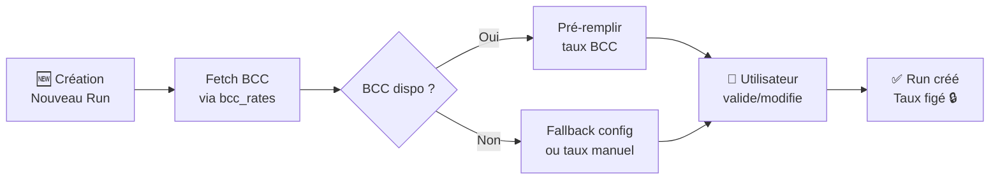

# Taux de Change & Multi-Devises — UX/UI

## Contexte Métier

Le système de paie Oxilière HR doit gérer deux réalités congolaises :

1. **Les valeurs légales** sont définies **en Francs Congolais (CDF)** par la loi : SMIG, plafonds CNSS, tranches IPR, allocations familiales, etc.
2. **Les salaires contractuels** sont souvent **en Dollars (USD)** , surtout pour les cadres, expatriés et certaines conventions collectives.

La conversion USD → CDF est obligatoire car **tous les calculs de paie se font en CDF** (tranches d'impôt, cotisations, abattements).

Le taux de change utilisé est celui de la **Banque Centrale du Congo (BCC)** , récupéré via le module `bcc_rates` qui scrape le site officiel de la BCC.

---

## 1. Création d'un Run de Paie — Le Sélecteur de Taux

### Flow complet



### Wireframe du formulaire

```
┌─────────────────────────────────────────────────────────────┐
│  ← Paies                                                    │
│                                                             │
│  ┌─────────────────────────────────────────────────────────┐│
│  │  📄  Nouvelle Paie                                      ││
│  │                                                         ││
│  │  Période                                                 ││
│  │  ┌────────────┐   ┌────────────┐                         ││
│  │  │ 01/06/2026 │   │ 30/06/2026 │                         ││
│  │  └────────────┘   └────────────┘                         ││
│  │                                                         ││
│  │  💱  TAUX DE CHANGE USD/CDF                              ││
│  │  ┌────────────────────────────────────────────────────┐ ││
│  │  │  ┌──────────────────────┐  ┌──────┐                │ ││
│  │  │  │  2 850,00           │  │  ⟳  │  ← Rafraîchir  │ ││
│  │  │  └──────────────────────┘  └──────┘                │ ││
│  │  │                                                    │ ││
│  │  │  ✓  BCC · Mis à jour il y a 5 min                 │ ││
│  │  │  📌  8 contrats en USD seront convertis            │ ││
│  │  └────────────────────────────────────────────────────┘ ││
│  │                                                         ││
│  │  [Annuler]                        [Créer la paie  🔒] ││
│  └─────────────────────────────────────────────────────────┘│
└─────────────────────────────────────────────────────────────┘
```

### Comportements attendus

| Cas | Comportement | Affichage |
|-----|-------------|-----------|
| **BCC disponible** | Fetch automatique à l'ouverture | Badge vert : `✓ BCC · Mis à jour il y a X min` |
| **BCC indisponible** | Fallback vers `PayrollConfiguration.exchange_rate_usd_cdf` | Badge jaune : `⚠️ Taux manuel (BCC indisponible)` |
| **Aucun taux configuré** | Champ vide, l'utilisateur doit saisir | Badge rouge : `❌ Taux requis` |
| **Refresh ⟳** | Nouveau fetch BCC, écrase la valeur | Spinner sur le bouton pendant le chargement |
| **Saisie manuelle** | L'utilisateur tape une valeur | Badge : `✏️ Saisie manuelle` |

### API associée

```
POST /api/payroll/runs/  →  Création du run
{
    "start_date": "2026-06-01",
    "end_date": "2026-06-30",
    "exchange_rate_applied": 2850.00,   // Optionnel : si null → auto-fetch
    "currency": "CDF"                    // Devise du run (toujours CDF)
}

GET /api/payroll/runs/bcc-preview/  →  Prévisualisation du taux BCC
{
    "bcc_rate": 2850.00,
    "fetched_at": "2026-06-27T12:00:00Z",
    "source": "bcc" | "config" | "manual",
    "contracts_in_usd": 8,
    "is_stale": false                    // > 24h ?
}
```

---

## 2. Détail du Run — Cartouche Taux

Après création du run, le taux est **figé**. Il ne peut plus être modifié une fois que la paie est validée.

```
┌─────────────────────────────────────────────────────────────┐
│  📊  Paie Juin 2026                        [BROUILLON]     │
│                                                             │
│  ┌──────────────────────────────────────────────────────┐  │
│  │  💱  TAUX DE CHANGE APPLIQUÉ                         │  │
│  │                                                     │  │
│  │       2 850,00  CDF/USD                             │  │
│  │                                                     │  │
│  │  Source    BCC (Banque Centrale du Congo)           │  │
│  │  Capturé   30/06/2026 à 09:15                      │  │
│  │  Statut    ✅ Figé (verrouillé après validation)    │  │
│  │                                                     │  │
│  │             [Modifier le taux]  (si RUN en DRAFT)   │  │
│  └──────────────────────────────────────────────────────┘  │
└─────────────────────────────────────────────────────────────┘
```

### États du taux

| Statut Run | Taux modifiable ? | Affichage |
|------------|------------------|-----------|
| **DRAFT** | ✅ Oui | `[Modifier le taux]` bleu, ouvre un dialogue |
| **VALIDATED** | ❌ Non, verrouillé | Badge `🔒 Figé`, pas de bouton |
| **APPROVED** | ❌ Non, verrouillé | Badge `🔒 Figé` |
| **PAID** | ❌ Non, verrouillé | Badge `🔒 Figé` |

### Dialogue de modification

```
┌──────────────────────────────────────────────┐
│  Modifier le taux de change                   │
│                                              │
│  Taux actuel : 2 850,00 CDF/USD              │
│                                              │
│  Nouveau taux :                               │
│  ┌────────────────────────┐  [⟳ BCC]        │
│  │                        │                  │
│  └────────────────────────┘                  │
│                                              │
│  ⚠️  Attention : modifier le taux            │
│     changera les montants de                 │
│     8 employés en USD.                       │
│                                              │
│  [Annuler]          [Appliquer & Recalculer] │
└──────────────────────────────────────────────┘
```

---

## 3. Table des Employés — Colonne Taux

Dans la liste des employés d'un run, chaque ligne montre comment le salaire est converti.

```
┌────┬────────────────┬──────────┬──────────┬──────────────┐
│    │ Employé        │ Salaire  │ Taux     │ En CDF       │
├────┼────────────────┼──────────┼──────────┼──────────────┤
│ ☐  │ Jean Mbemba    │ 2 000 USD│ 2 850,00 │ 5 700 000    │
│ ☐  │ Marie Kabasele │ 1 500 USD│ 2 850,00 │ 4 275 000    │
│ ☐  │ Albert Mbuyu   │ 850 000  │    —     │ 850 000      │
│ ☐  │ Paulin Bianga  │ 3 500 USD│ 2 850,00 │ 9 975 000    │
└────┴────────────────┴──────────┴──────────┴──────────────┘
```

### Règles d'affichage

| Salaire contractuel | Taux affiché | Salaire converti |
|--------------------|--------------|------------------|
| En **USD** | Le taux du run | `salaire × taux` |
| En **CDF** | `—` (tiret) | Identique au salaire (pas de conversion) |
| En **EUR** | `⚠️` Non supporté | Message d'erreur (conversion non implémentée) |

### Tooltip au survol du taux

```
┌──────────────────────────────────────┐
│  1 USD = 2 850,00 CDF                │
│                                      │
│  📅 Capturé le 30/06/2026 à 09:15   │
│  📡 Source : BCC                     │
│  🔒 Taux figé pour ce run           │
└──────────────────────────────────────┘
```

---

## 4. Fiche de Paie — Affichage du Taux

La fiche de paie doit montrer le taux appliqué et l'historique de conversion de manière transparente.

```
┌─────────────────────────────────────────────────────────────┐
│  📄  FICHE DE PAIE · Jean Mbemba                            │
│  Période : Juin 2026                                        │
│                                                             │
│  ┌────────────────────────────────────────────────────────┐ │
│  │  💱  SALAIRE CONTRACTUEL                               │ │
│  │                                                        │ │
│  │     2 000 USD                                          │ │
│  │     × 2 850,00  CDF/USD                                │ │
│  │     ─────────────────────                               │ │
│  │     5 700 000  CDF  ← Base de calcul                   │ │
│  │                                                        │ │
│  └────────────────────────────────────────────────────────┘ │
│                                                             │
│  Libellé                              Montant (CDF)         │
│  ─────────────────────────────────────────────────────────── │
│  Salaire de base                   5 700 000,00             │
│  Allocation logement                 300 000,00             │
│  Allocation transport                120 000,00             │
│  Allocations familiales               75 000,00             │
│  CNSS (5%)                          -285 000,00             │
│  IPR                                -532 500,00             │
│  ─────────────────────────────────────────────────────────── │
│  💰  NET À PAYER                  5 377 500,00  CDF        │
│                                                             │
│  ─────────────────────────────────────────────────────────── │
│  ℹ️  Taux BCC du 30/06/2026 · 1 USD = 2 850,00 CDF         │
│      Capturé au moment de la création du run                │
└─────────────────────────────────────────────────────────────┘
```

### Zone d'information en bas de fiche

Toujours présente, même si l'employé est en CDF (pour montrer qu'aucune conversion n'a été appliquée) :

| Cas | Texte |
|-----|-------|
| **Contrat USD** | `ℹ️ Taux BCC du 30/06/2026 · 1 USD = 2 850,00 CDF` |
| **Contrat CDF** | `ℹ️ Aucune conversion · Salaire en CDF` |
| **Taux manuel** | `ℹ️ Taux saisi manuellement · 1 USD = 2 850,00 CDF` |

---

## 5. États Limites & Edge Cases

### BCC indisponible au moment de la création

```
┌──────────────────────────────────────────────┐
│  ⚠️  Service BCC indisponible                 │
│                                              │
│  Le taux n'a pas pu être récupéré            │
│  automatiquement. Nous avons utilisé         │
│  le taux de votre configuration :            │
│  2 800,00 CDF/USD                            │
│                                              │
│  Vous pouvez :                               │
│  • Laisser ce taux et le modifier plus tard   │
│  • Saisir un taux manuellement               │
│  • Réessayer (⟳)                             │
│                                              │
│  [OK]                                        │
└──────────────────────────────────────────────┘
```

### Modification du taux après simulation

```
┌──────────────────────────────────────────────┐
│  ⚠️  Taux modifié après simulation            │
│                                              │
│  Vous avez déjà simulé cette paie avec       │
│  un taux de 2 850,00. La modification        │
│  du taux à 2 900,00 va :                     │
│                                              │
│  • Recalculer 8 fiches de paie               │
│  • Augmenter la masse salariale de           │
│    ~150 000 CDF                              │
│                                              │
│  [Annuler]    [Recalculer avec nouveau taux] │
└──────────────────────────────────────────────┘
```

### Contrat dans une devise non supportée

Dans la liste des employés, une ligne d'erreur apparaît pour les contrats EUR sans taux de conversion.

```
┌────┬────────────┬──────────┬────────┬────────────────────┐
│ ⚠️ │ Sophie D.  │ 3 000    │   —    │ Devise non         │
│    │            │ EUR      │        │ supportée          │
└────┴────────────┴──────────┴────────┴────────────────────┘
```

---

## 6. Composants UI

### `ExchangeRateInput.svelte`

Champ de saisie avec prévisualisation BCC, bouton de rafraîchissement et badge d'état.

```svelte
<script lang="ts">
  let {
    value = $bindable(0),
    label = "Taux de change USD/CDF",
    contractsInUsd = 0,
  } = $props();

  type RateStatus = "bcc" | "config" | "manual" | "error";
  let status = $state<RateStatus>("loading");
</script>
```

**Props :**
| Prop | Type | Défaut | Description |
|------|------|--------|-------------|
| `value` | `number` (bindable) | `0` | Taux actuel |
| `label` | `string` | `"Taux de change USD/CDF"` | Label du champ |
| `contractsInUsd` | `number` | `0` | Nombre de contrats USD impactés |
| `onFetch` | `() => Promise<number>` | — | Fonction de fetch BCC |

**États visuels :**
| Status | Badge | Couleur |
|--------|-------|---------|
| `"bcc"` | `✓ BCC · Mis à jour il y a X min` | Vert |
| `"config"` | `⚠️ Taux manuel (BCC indisponible)` | Jaune |
| `"manual"` | `✏️ Saisie manuelle` | Bleu |
| `"error"` | `❌ Taux requis` | Rouge |
| `"loading"` | `⟳ Chargement...` | Gris |

### `ExchangeRateCard.svelte`

Cartouche d'information affichée dans le détail d'un run.

```svelte
<script lang="ts">
  let {
    rate = 0,
    source = "bcc",
    fetchedAt = "",
    isLocked = false,
    onEdit = () => {},
  } = $props();
</script>
```

**États :**
- Mode **draft** : bouton `[Modifier]` visible
- Mode **validé/verrouillé** : badge `🔒 Figé`, pas de bouton

### `ExchangeRateTooltip.svelte`

Tooltip affiché au survol de la colonne "Taux" dans une table.

```svelte
<script lang="ts">
  let {
    rate = 0,
    source = "bcc",
    fetchedAt = "",
    contractCurrency = "USD",
  } = $props();
</script>
```

---

## 7. Modèle de Données — Backend

### PayrollRun (extension)

```python
class PayrollRun(models.Model):
    # ... champs existants ...
    exchange_rate_applied = models.DecimalField(
        max_digits=10,
        decimal_places=2,
        null=True,
        blank=True,
        help_text="Taux USD/CDF appliqué pour ce run. Null si tous les contrats sont en CDF."
    )
    exchange_rate_source = models.CharField(
        max_length=20,
        choices=[("bcc", "BCC"), ("config", "Configuration"), ("manual", "Saisie manuelle")],
        default="bcc",
    )
    exchange_rate_fetched_at = models.DateTimeField(
        null=True, blank=True,
        help_text="Date/heure de la récupération du taux"
    )
    currency = models.CharField(
        max_length=3,
        default="CDF",
        help_text="Devise de calcul du run (toujours CDF)"
    )
```

### PayrollConfiguration

```python
class PayrollConfiguration(models.Model):
    exchange_rate_usd_cdf = models.DecimalField(
        max_digits=10, decimal_places=2, null=True, blank=True,
        help_text="Taux de change USD → CDF de la configuration (fallback si BCC indisponible)"
    )
    exchange_rate_source = models.CharField(
        max_length=20, choices=[("bcc", "BCC"), ("manual", "Manuel")],
        default="bcc",
    )
```

---

## 8. Résumé — Règles Métier

| # | Règle | Justification |
|---|-------|---------------|
| 1 | Le taux est **figé à la création du run** | Piste d'audit : on sait exactement quel taux a été utilisé |
| 2 | Tous les employés du même run utilisent **le même taux** | Équité entre employés |
| 3 | Le taux est **modifiable en DRAFT** uniquement | Pas de modification après validation |
| 4 | La modification du taux **déclenche un recalcul** | Cohérence des montants |
| 5 | Les valeurs légales sont **toujours en CDF** | Définition légale (loi congolaise) |
| 6 | Le BCC est la **source prioritaire** avec fallback config | Robustesse + fiabilité |
| 7 | Le taux source est **tracé** (BCC/config/manuel) | Transparence pour l'audit |
