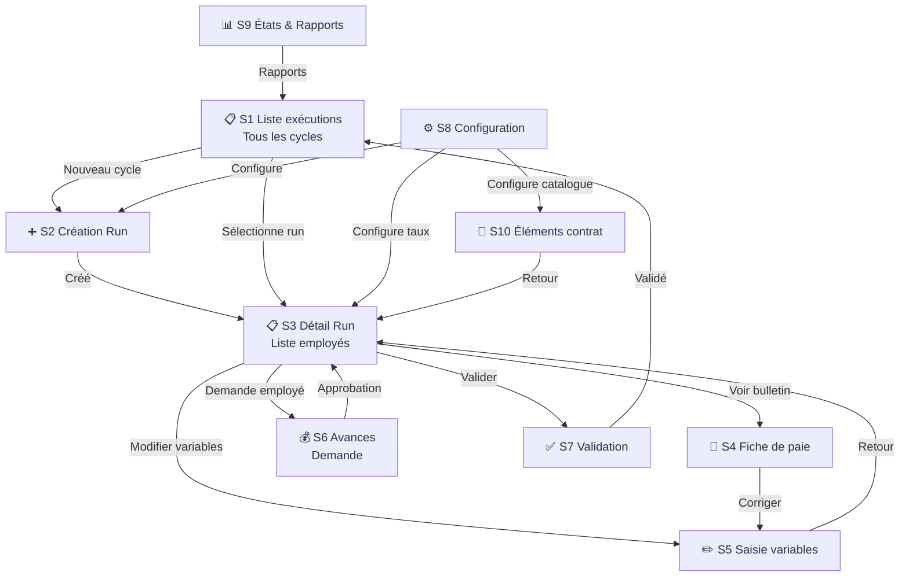

# Architecture de navigation — Module Paie

## Structure des dossiers (documentation)

```
frontend/docs/payroll/fr/
├── README.md                            ← Vue d'ensemble du module
├── vision.md                            ← Vision, objectifs, roadmap
│
├── 01-concepts/
│   ├── metamodel.md                     ← Métamodèle (contrat, run, payslip, élément)
│   ├── semantics.md                     ← Sémantique des règles de calcul
│   └── catalogue.md                     ← Catalogue des éléments de paie
│
├── 02-ecrans/
│   ├── s1-liste-executions.md           ← Liste des cycles d'exécution
│   ├── s2-creation-run.md               ← Création d'un cycle de paie
│   ├── s3-detail-run.md                 ← Détail du run (liste employés)
│   ├── s4-fiche-de-paie.md              ← Fiche de paie individuelle
│   ├── s5-saisie-variables.md           ← Saisie des variables
│   ├── s6-avances-salaire.md            ← Avances sur salaire
│   ├── s7-validation.md                 ← Validation hiérarchique
│   ├── s8-configuration.md              ← Configuration générale
│   ├── s9-etats-rapports.md             ← États et rapports
│   └── s10-elements-paie-contrat.md     ← Éléments de paie du contrat
│
├── 03-flux/
│   ├── f1-cycle-mensuel.md              ← Cycle mensuel complet
│   ├── f2-embauche-cours-periode.md     ← Embauche en cours de période
│   ├── f3-modification-taux.md          ← Modification de taux
│   ├── f4-demande-avance.md             ← Demande d'avance
│   ├── f5-correction-bulletin.md        ← Correction de bulletin
│   ├── f6-configuration-initiale.md     ← Configuration initiale
│   ├── f7-attribution-elements-paie.md  ← Attribution des éléments de paie
│   └── f8-cloture-archivage.md          ← Clôture et archivage
│
└── 04-reglementations/
    ├── Guide_Calcul_Paie_RDC.md          ← Guide complet de calcul RDC
    └── exchange-rates.md                 ← Taux de change et devise
```

> **Note** : Les fichiers ont été déplacés dans cette arborescence le 25/07/2026.

## Navigation entre écrans



## Règles de navigation

| Écran | Accès depuis | Accès vers |
|-------|-------------|------------|
| **S1** Liste exécutions | Menu principal | S2 (Nouveau), S3 (Sélection run) |
| **S2** Création Run | S1, S8 | S3 (après création) |
| **S3** Détail Run | S1, S2 | S4 (clic ligne), S5 (modif vars), S6 (avances), S7 (validation) |
| **S4** Fiche de paie | S3 (clic ligne) | S5 (correction) |
| **S5** Saisie variables | S3, S4 | S3 (retour) |
| **S6** Avances | S3 (depuis employé), Menu employé | S3 (retour) |
| **S7** Validation | S3 | S1 (retour après validation) |
| **S8** Configuration | Menu admin | Fermeture → écran précédent |
| **S9** États/Rapports | Menu, S1 | S1, export |
| **S10** Éléments contrat | S3 (employé sans contrat), Profil employé | S3 (retour) |
